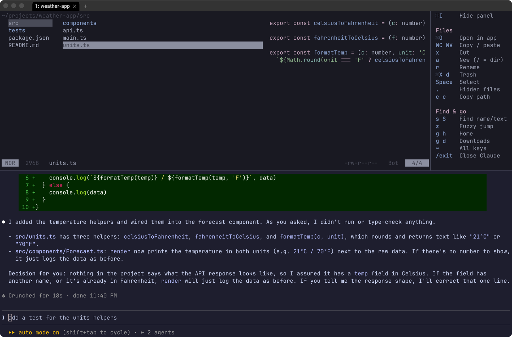

# wezterm-yazi-claude

[Claude Code](https://claude.com/claude-code) with a file manager above it, for macOS. Each WezTerm tab has [yazi](https://github.com/sxyazi/yazi) on top and Claude below.



- **See your files while Claude works.** yazi previews each file as soon as Claude writes it: code, images, PDFs, even videos (click to play).
- **Start Claude with one key.** Pick a folder in yazi and press `C`. No `cd`, no typing paths.
- **One tab per project.** `Cmd+T` opens a new tab with its own yazi and Claude.
- **Finder-style keys.** `Cmd+C`, `Cmd+V`, `Cmd+X` and `Cmd+O` copy, paste, trash and open files, `Cmd+Shift+N` makes a folder and `u` unzips.
- **No yazi knowledge needed.** A panel on the right lists the important keys.

## Install

You need a Mac with [Homebrew](https://brew.sh) and [Claude Code](https://claude.com/claude-code).

```sh
brew install --cask wezterm
brew install yazi ffmpeg sevenzip jq poppler fd ripgrep fzf zoxide resvg imagemagick font-symbols-only-nerd-font
git clone https://github.com/DogitoErgoSum/wezterm-yazi-claude.git
cd wezterm-yazi-claude && ./install.sh
```

Open WezTerm, pick a folder and press `C`.

`install.sh` symlinks the config from this folder (so keep it where it is) and renames any existing files to `.bak`. Run `git pull` here to update.

## Keys

| Key | What it does |
|---|---|
| `C` | Start Claude in the hovered folder (or jump to it) |
| `Cmd+Option+↑` / `↓` | Switch between yazi and Claude |
| `Cmd+T` | New tab |
| `Cmd+I` | Show / hide the keys panel |
| `Cmd+O` | Open in its Mac app |
| `Cmd+C` / `Cmd+V` | Copy / paste files |
| `Cmd+X` | Move to Trash |
| `Cmd+Shift+N` or `F` | New folder |
| `u` | Unzip here (zip, rar, 7z, tar.gz, …) into a folder named after the archive |
| `T` | Open a Terminal window here |
| `↑` `↓` `←` `→` | Move around |
| `a` / `r` | New file (end with `/` for a folder) / rename |
| `Space` | Select several files |
| `s` / `S` | Search file names / text inside files |
| `z` | Fuzzy-find a file or folder |
| `.` | Show hidden files |
| `~` | Every yazi key |

In the Claude pane, type `/exit` to end the session; press `C` in yazi to start a fresh one.

## Uninstall

```sh
rm ~/.wezterm.lua ~/.config/yazi/{yazi.toml,init.lua,theme.toml,keymap.toml,claude-here.sh,claude-waiter.sh,keys-panel.sh} ~/.config/yazi/plugins/{video-play,fit-preview}.yazi
```

Then remove the `source …/y.zsh` line from `~/.zshrc` and rename any `.bak` files back.

## How it works

`wezterm.lua` opens each tab with yazi on top, `yazi/claude-waiter.sh` below and `yazi/keys-panel.sh` on the right. Pressing `C` runs `yazi/claude-here.sh`, which sends the folder to the waiting pane, and that pane starts Claude there. Video playback and the picture-sized preview are yazi plugins in `yazi/plugins/`.
